# The Animal Detective

**Can a computer work out what makes a mammal a mammal, if nobody ever tells it?**

That is the whole project. We hand a computer a book of 277 animals described only by
simple yes or no facts (does it have fur, does it lay eggs, can it fly), and we ask it to
invent its own game of twenty questions for telling a bird from a beetle.

It figures out a good game in about a second. Then it does two more surprising things:
when we tear the answers out of the book entirely, it rebuilds most of the animal kingdom
by itself, and when we point the same machinery at a completely different question, it
turns out to know roughly how long each animal will live.

<p align="center">
  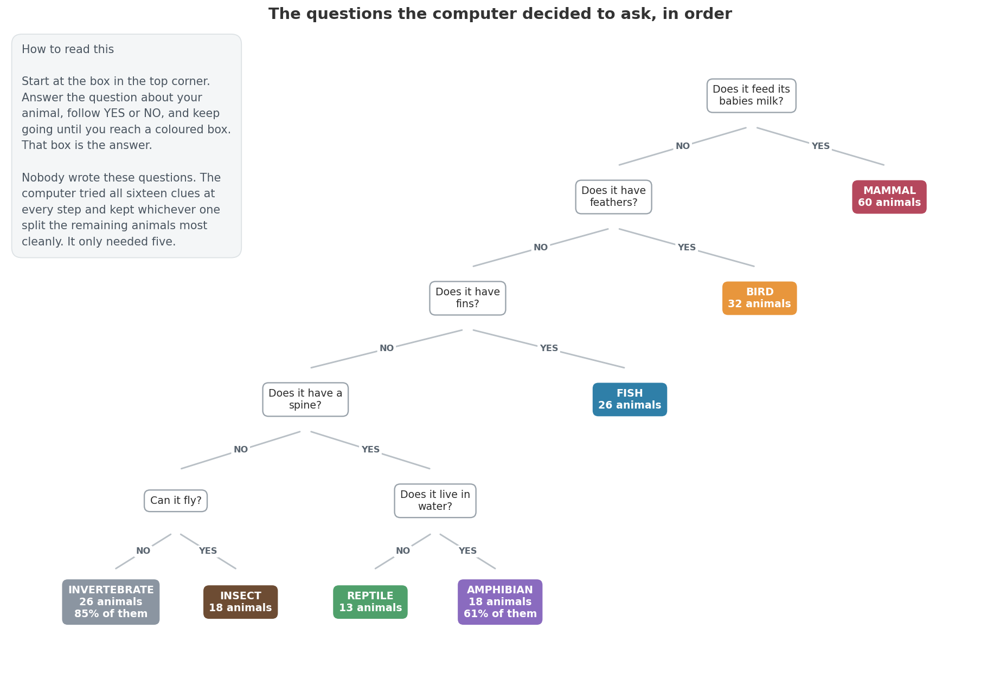
</p>

That picture is the finished result. Read it top right to bottom left. Nobody wrote those
five questions. The computer chose them, in that order, out of sixteen it could have
picked from.

---

## The short version, with no jargon

You know the game where you think of an animal and someone has twenty questions to guess
it? A good player does not start with "is it a badger". A good player starts with a
question that cuts the world roughly in half, like "does it live in water".

That is exactly what this program does, except it is ruthless about it. At every step it
tries all sixteen questions it is allowed to ask, measures which one leaves the tidiest
piles behind, and keeps that one. Then it does the same thing again inside each pile.

Its very first question turns out to be **"does it feed its babies milk?"**, which pulls
every single mammal out of the pile in one move and never gets it wrong. Its second is
**"does it have feathers?"**, which does the same for birds. Five questions in, it has
sorted the entire animal kingdom.

You could have guessed those questions yourself. That is the point. The interesting part
is that nobody gave them to it, and it found them by counting.

---

## Try it

**[Open the live demo](https://claude.ai/artifact/A1ijt9cHKeyJt1XnSLbbMH)**,
or open **[`demo/index.html`](demo/index.html)** from this repo in any browser. No install,
no server, no internet needed for the local copy.

There are two things to play with.

### 1. Describe an animal

Flip switches to describe any creature you like and watch it reason in real time. There is
a preset called **the zorblax**, which is a furry, feathered, venomous, eight legged flying
thing that does not exist. The detective calls it a bird, with 100% confidence, because it
has feathers and does not produce milk.

That failure is deliberate and it is the most useful thing in the project. A model like
this has no concept of "that is not an animal". It was only ever taught to sort things into
seven boxes, so seven boxes is all it can ever answer. Confidence is not the same as being
right.

### 2. Let it guess your animal

The second tab plays the game in reverse. You think of an animal, it asks questions, and it
narrows all 277 down to one. It picks each question with the same rule that built the tree:
try everything still available, keep whichever one splits the survivors most evenly.

Think of a penguin and it gets there in five questions:

```
How many legs does it have?      2      277 -> 54
Does it hunt other animals?      yes     54 -> 25
Does it live in water?           yes     25 -> 10
Is it at least as big as a cat?  yes     10 -> 6
Can it fly?                      no        6 -> 1      "Is it a penguin?"
```

Nothing is precomputed. The narrowing happens live in the page, over the same book the
model learned from.

---

## What it actually learned

### It beats the lazy answer by a mile

<p align="center">
  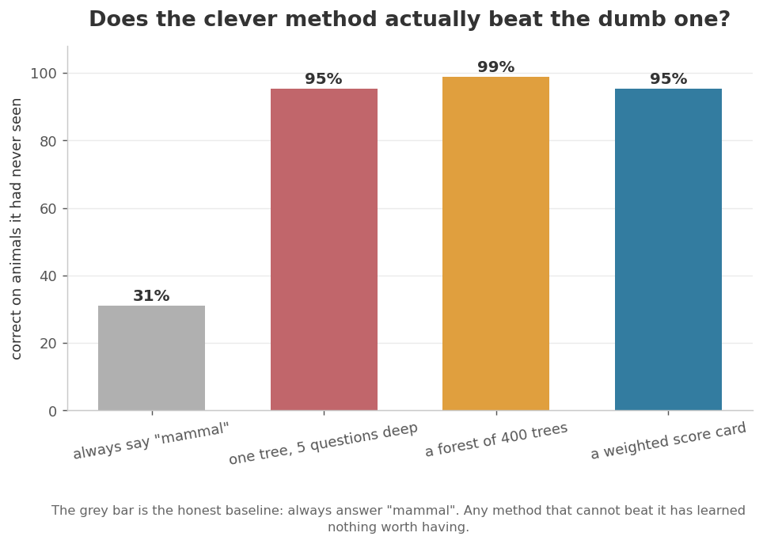
</p>

The grey bar is the honest floor. About a third of the book is mammals, so a program that
just says "mammal" every single time scores 31% without learning anything at all. Any
result you cannot compare against that number is meaningless.

The five question tree gets **95.2%** of the 84 unseen animals right. Reshuffling the book
five different ways gives 93.5%, plus or minus 2.1, so that is not a fluke of one lucky
split. A forest of 400 trees reaches 98.8%, which is a fair trade to think about: you buy
about three more correct answers out of eighty four, and you pay for them with a model that
no longer fits on one page.

### If you could only ask one question

<p align="center">
  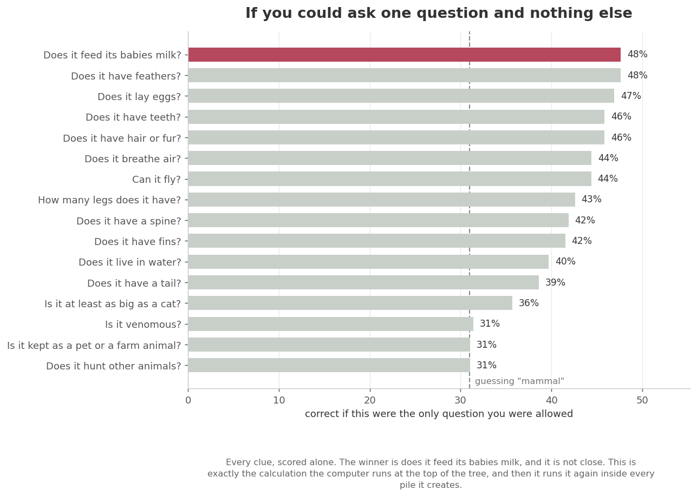
</p>

Every clue, scored alone, as if it were the only thing you were allowed to ask. Milk wins
at 48% and it is not close. Asking whether an animal hunts other animals scores 31%, which
is exactly what you get by not asking anything at all.

This chart is the algorithm. The computer runs this calculation at the top of the tree,
picks the winner, and then runs it again inside every pile it creates.

### Five questions is enough, and forty animals is nearly enough

<p align="center">
  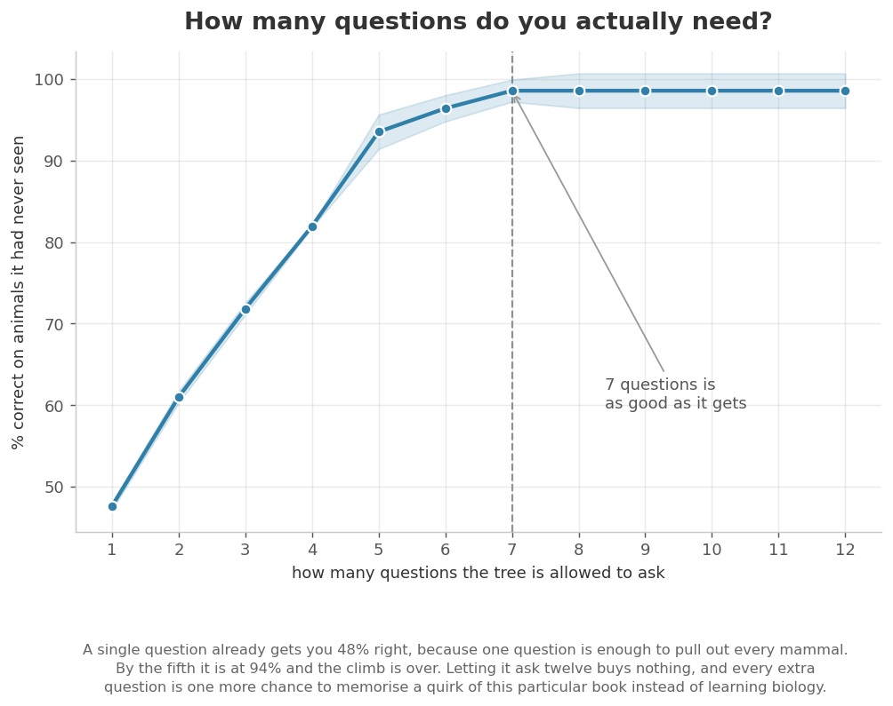
</p>

<p align="center">
  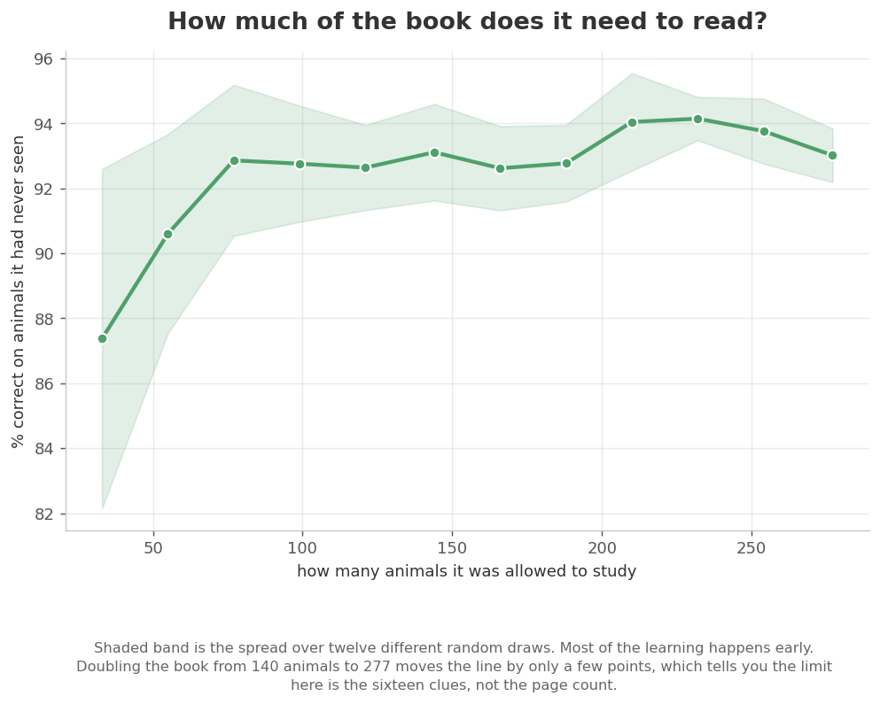
</p>

The first curve says the climb is over by the seventh question and the fifth gets you most
of the way. The second says something more uncomfortable: having read only 33 animals it
already scores 87%, and reading all 277 takes it to 93%.

Eight times the data for six points. That is worth sitting with, because the instinct in
this field is always to collect more rows. Here the ceiling is the sixteen clues, not the
page count. To do better you would need to ask a different kind of question, not read a
longer book.

### Only a few clues carry any weight

<p align="center">
  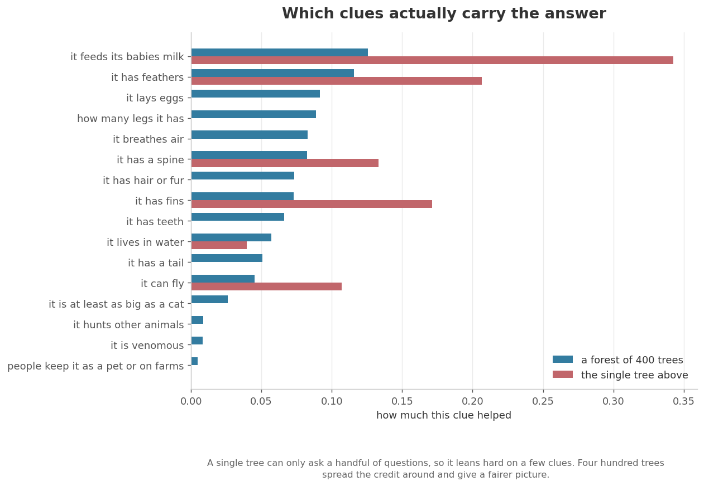
</p>

Sixteen facts go in. Four or five do almost all the work. Whether an animal is venomous,
or someone keeps it as a pet, turns out to be nearly worthless for saying what it is.

Here is the sharpest way to see that. Take a lion, make sixteen copies, and change exactly
one fact in each copy:

<p align="center">
  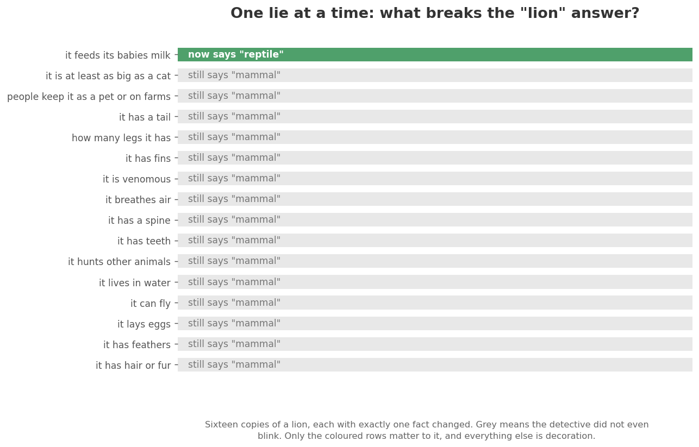
</p>

You can tell the detective that a lion has feathers, lives underwater, has eight legs and
is kept as a pet, and it will still calmly answer "mammal". Exactly one lie breaks it:
telling it lions do not feed their babies milk.

### Which is also exactly why it is fragile

<p align="center">
  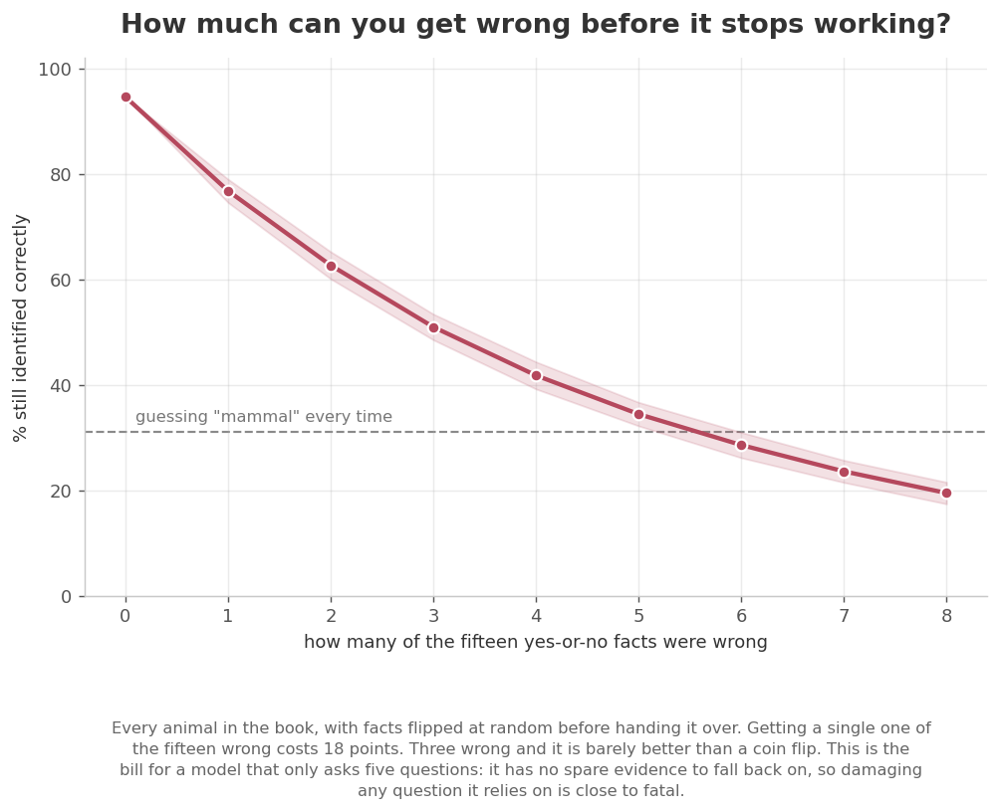
</p>

Same idea, done at random and across the whole book. Get **one** of the fifteen yes or no
facts wrong and accuracy falls 18 points. Get three wrong and it is barely better than a
coin flip.

This is the bill for a model you can read on one page. It leans its entire weight on a
handful of questions, so it has no spare evidence to fall back on when one of them is
damaged. The forest of 400 trees is harder to read and much harder to knock over, and that
is the actual tradeoff, not accuracy.

### It knows what it is confused about

<p align="center">
  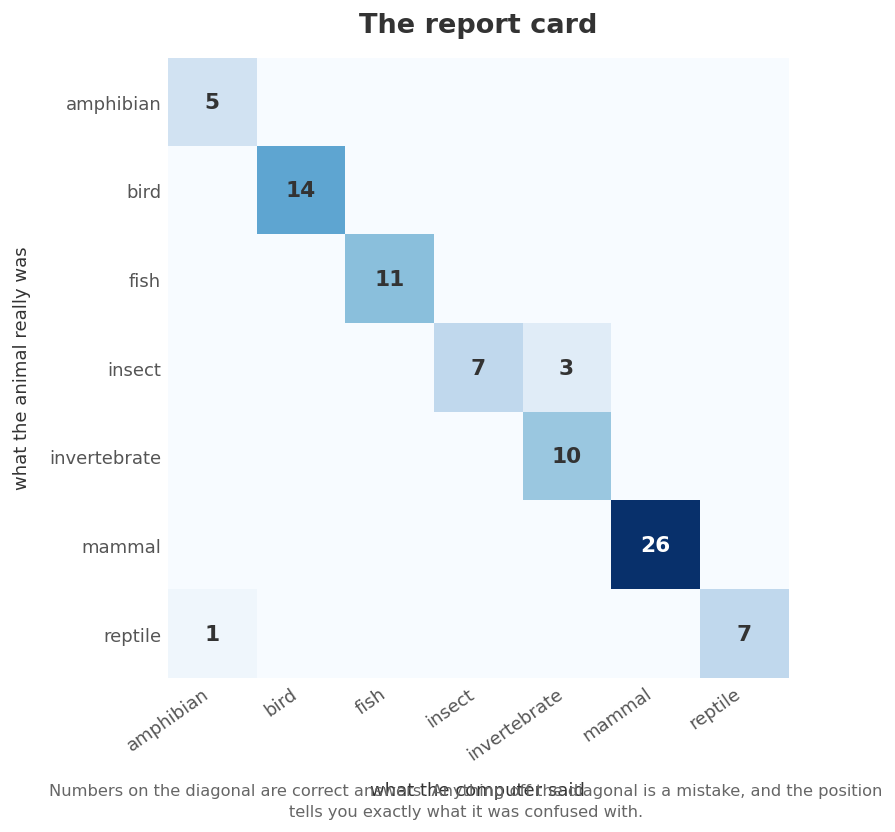
</p>

Correct answers sit on the diagonal. The mistakes are not random, and where they land tells
you why. Amphibians get muddled with reptiles, because on a sheet of yes and no answers a
newt and a gecko look nearly identical. To separate those two you would need a clue the
book does not contain, like whether the skin is wet or scaly.

---

## The part that is genuinely strange

Everything above involved showing the computer the right answers. So we tried the opposite.
We tore the family names out of the book and handed over nothing but sixteen columns of
yes and no. No labels. No hint that "mammal" is even a concept.

Then we asked it to sort 277 animals into seven piles however it liked.

<p align="center">
  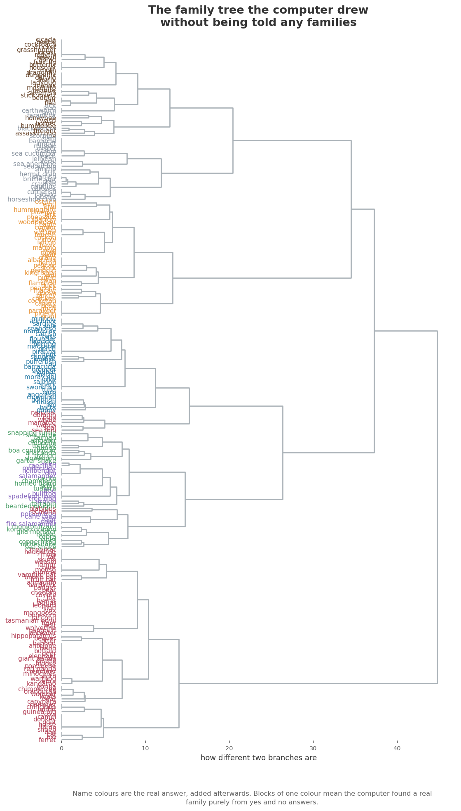
</p>

The colours in that picture were painted on afterwards, purely to mark the answer sheet.
The computer never saw them. The blocks of solid colour are it rediscovering biology from
scratch.

It scores **0.85** where 1.0 is a perfect match with real taxonomy and 0.0 is random
sorting. Birds, fish, reptiles, amphibians and insects each came out as one clean,
complete pile. Mammals were the exception: the computer split them into three piles,
because without being told otherwise it decided that a dolphin belongs with the whales and
not with the horses. Which is a perfectly reasonable thing to think if all you have ever
seen is a checklist.

<p align="center">
  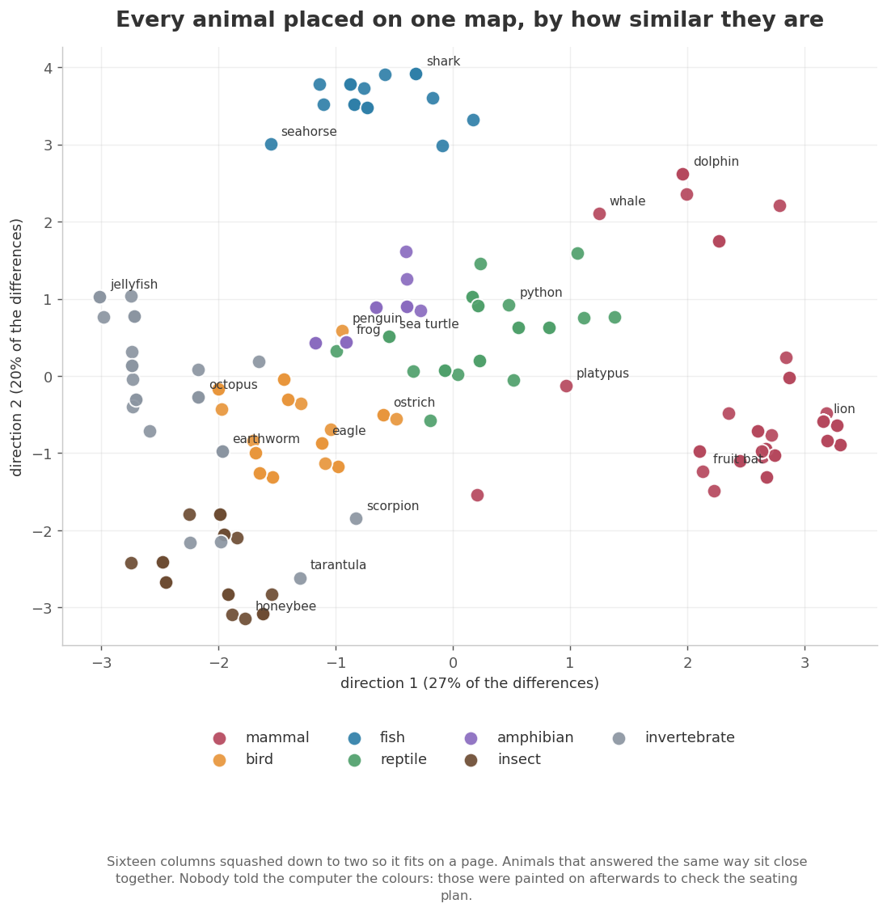
</p>

The same idea as a map. Sixteen columns squashed down to two so it fits on a page, with
similar animals placed near each other. The sea mammals drift up toward the fish. The
platypus sits out on its own, as it should.

### Who is your closest relative?

<p align="center">
  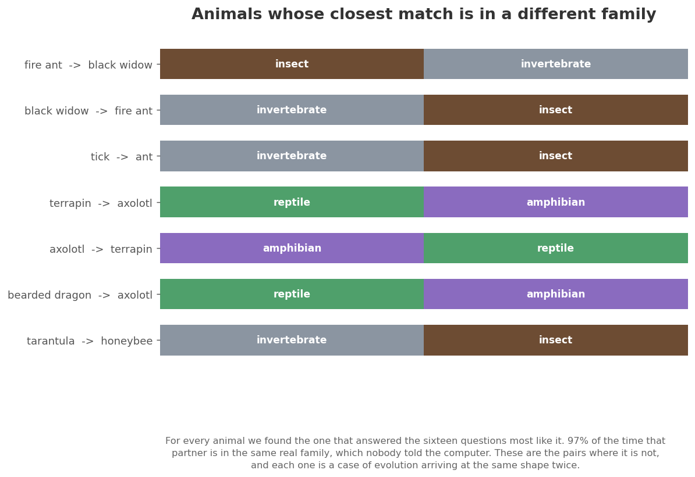
</p>

For every animal we found the one that answered the sixteen questions most like it. **97%**
of the time that partner belongs to the same real family, which again nobody ever told the
computer.

The chart shows the pairs where it does not, and every one of them is a real story rather
than an error. A fire ant's nearest match is a black widow. An axolotl's is a terrapin.
These are cases where evolution arrived at the same answer twice from different directions,
and a checklist genuinely cannot tell them apart.

---

## A different question entirely: how long will it live?

Everything so far has been sorting into boxes. This part asks for a number.

Each animal in the book also carries its typical weight and lifespan, which the sorting
model is never allowed to see. Using those, we can ask whether the same machinery can guess
how long an animal lives from nothing but its shape and habits.

<p align="center">
  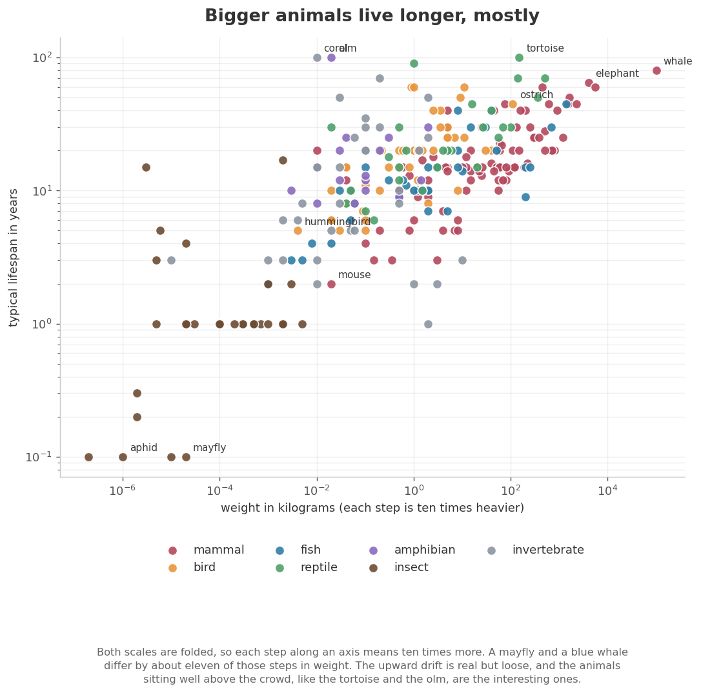
</p>

The old rule of thumb is that bigger animals live longer, and you can see it: the cloud
drifts upward. Both scales are folded so that each step means ten times more, because a
mayfly and a blue whale do not share a ruler.

Weight alone explains **51%** of the differences in lifespan. Adding the sixteen yes and no
clues takes that to **63%**, and the typical guess ends up wrong by a factor of 1.47, with
74% of animals landing within a factor of two of the truth.

<p align="center">
  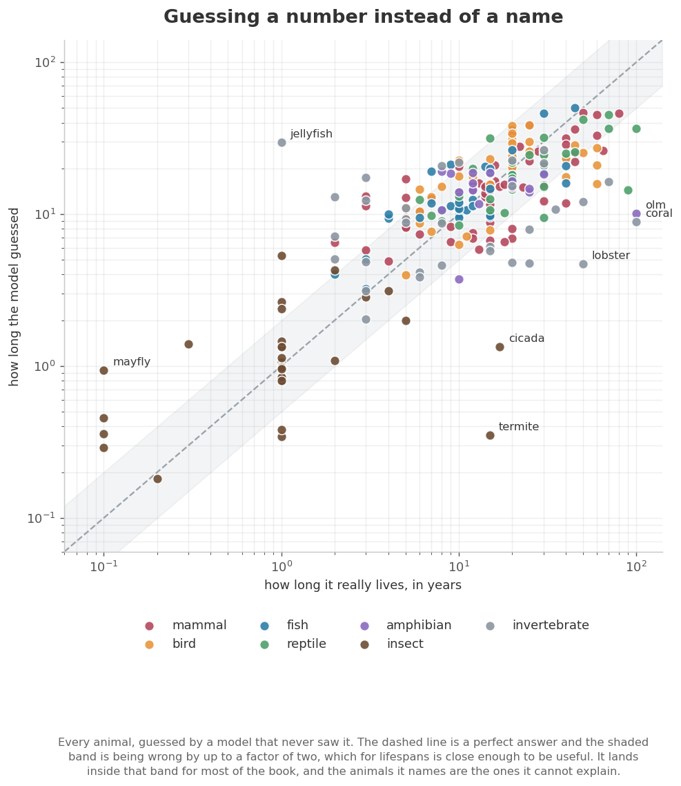
</p>

But the failures are the good part.

<p align="center">
  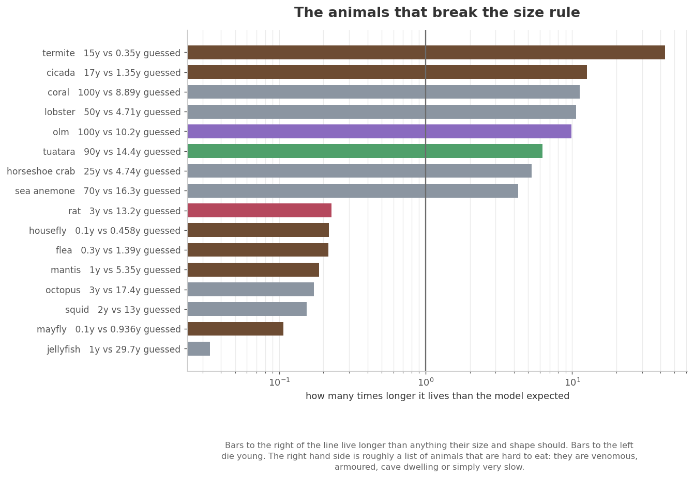
</p>

The animals that live far longer than their size says they should are not a random
selection. A termite queen outlives the prediction by **43 times**. Then a cicada, a coral,
a lobster, an olm and a tuatara.

Read that list again and a pattern falls out: they are all animals that are hard to kill.
Sealed inside a mound, underground for seventeen years, cemented to a reef, armoured, or
living in a lightless cave with no predators in it. The model has no idea about any of
that. It only knows it guessed wrong, and the direction it guessed wrong in happens to
point straight at one of the real explanations for why animals age.

That is what a residual is for. The thing your model cannot explain is often more
interesting than the thing it can.

---

## Where it breaks, honestly

- **It cannot say "I don't know."** The zorblax proves it. Every input gets one of seven
  labels and a confident percentage next to it.
- **A short tree is brittle.** One wrong fact out of fifteen costs 18 points of accuracy.
- **It misses things the clues cannot express.** Of twelve real animals kept out of the
  book entirely, it identified eleven. The one it failed is the water strider, an insect
  that cannot fly, which the tree files as an invertebrate because "can it fly" is the only
  question standing between those two answers.

<p align="center">
  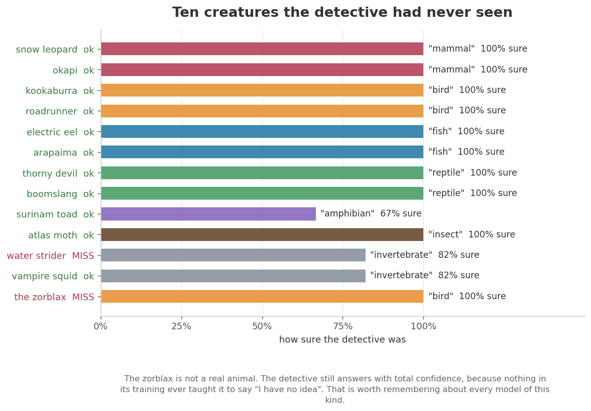
</p>

- **Its confidence is not a probability of being right.** 100% means every animal in that
  corner of the training book agreed, and that book has 277 rows in it.
- **The odd ones out stay odd.** The platypus survives here only because milk is the very
  first question. Reorder the questions and it becomes a reptile.

<p align="center">
  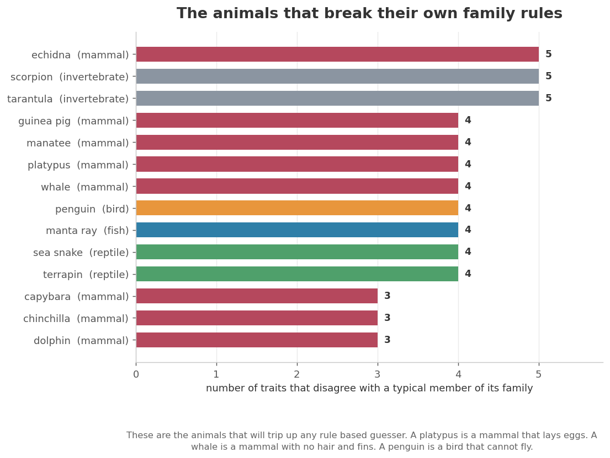
</p>

- **The families are lopsided.** There are 86 mammals and 16 amphibians, and the report card
  shows exactly where that bites.
- **The data is hand written by a person**, from ordinary biology. A different person would
  argue about whether a seal has legs or fins, and the model would shift accordingly.

---

## Run it

```bash
pip install -r requirements.txt
python src/run_all.py
```

That rebuilds the dataset, redraws all twenty one charts, retrains everything and
regenerates the demo page. It takes under a minute and needs no internet.

Or run the steps one at a time, which is the better way to read it:

| Step | Command | What happens |
|---|---|---|
| 0 | `python src/build_dataset.py` | Writes the book of 277 animals |
| 1 | `python src/step1_explore.py` | Counts them and draws what each family looks like |
| 2 | `python src/step2_learn.py` | Teaches the tree, scores it, writes the rules in English |
| 3 | `python src/step3_discover.py` | Hides the answers and sees what it invents on its own |
| 4 | `python src/step4_mystery.py` | Unseen creatures, the one-lie test, the robustness test |
| 5 | `python src/step5_lifespan.py` | Guesses a number instead of a name |
| 6 | `python src/build_demo.py` | Rebuilds the interactive page and the guessing game |

---

## What is in here

```
animal-detective/
├── data/animals.csv                     277 animals, 16 clues plus size, lifespan and diet
├── src/
│   ├── build_dataset.py                 the animal book, written by hand
│   ├── common.py                        shared colours, wording and settings
│   ├── step1_explore.py                 look before you learn
│   ├── step2_learn.py                   train, score, and translate into English
│   ├── step3_discover.py                the same job with the answers removed
│   ├── step4_mystery.py                 unseen creatures, lies, and corrupted facts
│   ├── step5_lifespan.py                predicting a number instead of a category
│   ├── build_demo.py                    bakes the model and the book into a web page
│   └── run_all.py                       all of the above, in order
├── demo/
│   ├── index.html                       open in a browser, works offline
│   └── page.html                        the same page without the html wrapper
└── outputs/
    ├── figures/                         all twenty one charts
    ├── the_rules_in_plain_english.txt   the model, as sentences
    ├── detailed_scores.txt              per family precision and recall
    ├── lifespan_scores.txt              how the number guessing did
    ├── tree.json                        the finished model, under 2 KB of nested questions
    └── tree_measured.json               the step 2 tree, the one the scores describe
```

The trained classifier really is just `outputs/tree.json`. Under two kilobytes of nested
questions. You can open it in a text editor and read the entire mind of the thing, which is
not something you can say about most machine learning.

---

## The data

Sixteen clues per animal, all of them checkable by a curious child at a zoo: hair,
feathers, eggs, milk, airborne, aquatic, predator, toothed, backbone, breathes, venomous,
fins, legs, tail, domestic, catsize. Seven families: mammal, bird, fish, reptile,
amphibian, insect, invertebrate.

<p align="center">
  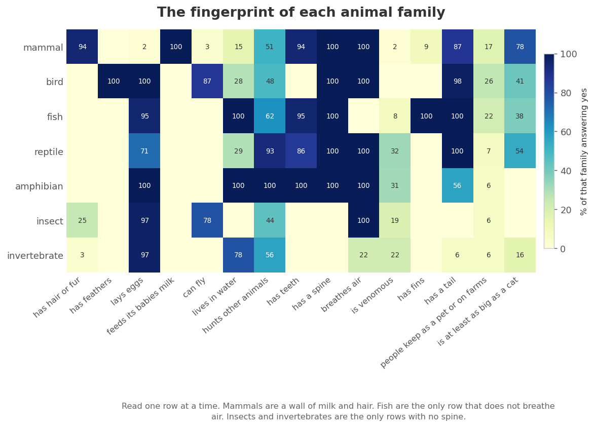
</p>

Three further columns, kept deliberately away from the sorting model and used only in step
5: typical adult weight, typical lifespan, and whether it eats meat, plants or both.

The table is written out by hand in `src/build_dataset.py`, in the spirit of the UCI Zoo
dataset but rebuilt from ordinary biology, at more than twice the size, with deliberate
troublemakers added: a platypus, an echidna, a caecilian, a legless lizard, flightless
birds, air breathing fish, a toothless anteater and a mammal with fins. They exist
specifically to punish anything that learns a rule too confidently.

## Built with

Python, pandas, scikit-learn, matplotlib, scipy. Nothing else.
